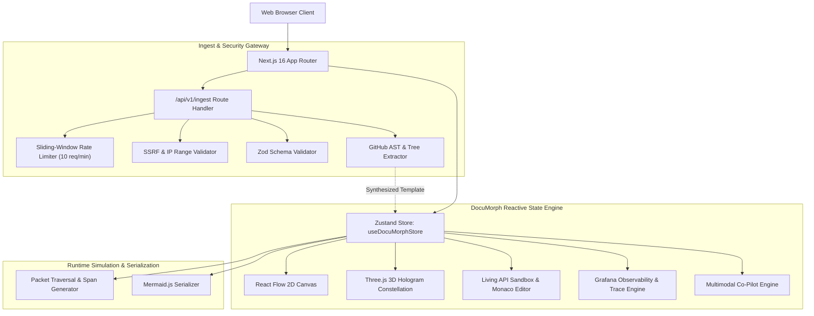

# 🏛️ DocuMorph Technical Architecture Specification

## 1. System Philosophy & Objectives
DocuMorph bridges the gap between passive technical specifications (Markdown/OpenAPI), code repositories, and runtime execution. It provides:
1. **Interactive 2D Architecture Canvas** (`@xyflow/react`) with quick-add node palette and drag-and-drop edge wiring.
2. **Interactive 3D WebGL Hologram Constellation** (`three.js`) with 360° orbital controls, particle packet surges, and raycast HUD tooltips.
3. **Secure Code Link Ingestor** that analyzes public GitHub repositories and synthesizes living architectures in real time.
4. **Living API Sandbox** with Monaco Editor and simulated packet flow across the dependency graph.
5. **Grafana-Style Observability & Distributed Trace Waterfall** (OpenTelemetry / Tempo / Jaeger spec).
6. **Multimodal Technical Co-Pilot** powered by Gemini 2.0 reasoning patterns.

---

## 2. High-Level Topology

---

## 3. Core Subsystems

### A. Dynamic 2D Canvas Engine (`src/components/canvas/`)
- Built upon `@xyflow/react` v12.
- **Node Types:** Custom `ServiceNode` supporting six distinct node classifications:
  - `gateway`: Reverse proxy, SSL termination, routing (Envoy, Kong, Cloudflare).
  - `service`: Microservice and computational workers.
  - `database`: PostgreSQL, MongoDB, Pinecone vector stores.
  - `queue`: Apache Kafka, RabbitMQ event streams.
  - `ai_agent`: Multimodal LLM reasoners (Gemini 2.0).
  - `cache`: Redis distributed in-memory cache.
- **Dynamic Connection:** User drag-and-drop linking via `onConnect` automatically registers animated edges in the global state store.
- **Mermaid Exporter:** One-click serialization to GitHub Flavored Markdown diagrams.

### B. Interactive 3D WebGL Hologram Constellation (`src/components/canvas3d/`)
- Built upon **Three.js** `v0.186`.
- **Role-Based 3D Geometry**:
  - `gateway`: Cyan octahedron with dual rotating gyroscopic rings.
  - `ai_agent`: Rose icosahedron with 3 orbiting quantum satellite spheres.
  - `database`: Emerald neon cylinder with segmented discs.
  - `queue`: Amber energetic torus.
  - `service`: Indigo chamfered cube with an inner glowing energy core.
  - `cache`: Teal double-cone diamond.
- **Arched 3D Edge Beams:** Quadratic bezier curves connecting microservices with real-time flowing light packets.
- **Multiple Layout Modes:** `tiered` (hierarchical tiers), `orbital` (planetary galaxy), and `constellation` (Fibonacci matrix).
- **Interactive Raycasting:** Hovering over any 3D node projects screen coordinates to display an ethereal cyberpunk HUD with live P95 latency and SLA; clicking a node focuses the camera and inspects the service.

### C. Secure Code Link Ingestion & Synthesis Engine (`src/app/api/v1/ingest/` & `src/lib/`)
- **Automated Repository AST Analysis**:
  - Fetches repository tree and manifests (`package.json`, `requirements.txt`, `go.mod`, Dockerfiles).
  - Auto-discovers web frameworks, databases, and microservices.
  - Discovers live REST endpoints from route files (`/app/api/**`, `/api/**`, `/routes/**`).
  - Synthesizes 2D nodes, 3D coordinates, mock payloads, and Markdown documentation automatically.
- **Security Guardrails**:
  - **Rate Limiting:** In-memory sliding-window limiter enforcing 10 requests / minute per client IP.
  - **SSRF Prevention:** Strict domain whitelisting (`github.com`); blocks all private IP spaces (`127.0.0.1`, `localhost`, `10.0.0.0/8`, `172.16.0.0/12`, `192.168.0.0/16`, `169.254.169.254`).
  - **Runtime Validation:** Zod schema validation on request payloads.
  - **XSS Sanitization:** Deep scrubbing of dangerous HTML and script tags before presentation.
  - **Timeout Protection:** 8-second `AbortController` timeout on all upstream calls.

### D. Living API Sandbox (`src/components/playground/`)
- Ingests mock response specifications and JSON schema definitions per endpoint.
- Integrates `@monaco-editor/react` for payload manipulation with live JSON validation.
- When an execution is dispatched, the runner triggers sequential packet traversal animations across upstream and downstream dependencies.

### E. Grafana-Style Observability Engine (`src/components/observability/`)
- Synthesizes real-time time-series telemetry:
  - **Requests per Second (RPS):** Dynamic throughput calculation.
  - **Latency Percentiles:** P50, P95, and P99 latency bounds per microservice.
  - **Distributed Trace Waterfall:** Generates span hierarchies compatible with OpenTelemetry and Grafana Tempo specs, calculating relative offsets and execution durations.
  - **3D Card Parallax:** Interactive hover tilt and specular glare on all KPI stats.

### F. Multimodal Technical Co-Pilot (`src/components/copilot/`)
- Context-aware technical assistant analyzing active architecture topologies.
- Recommends failover strategies, caching layers, and latency optimizations based on graph bottlenecks.
