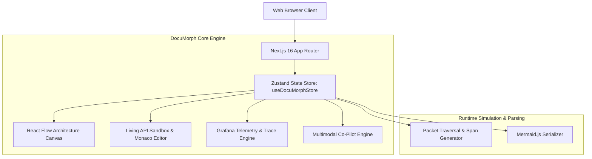

# 🏛️ DocuMorph Technical Architecture Specification

## 1. System Philosophy & Objectives
DocuMorph bridges the gap between passive technical specifications (Markdown/OpenAPI) and runtime execution. It provides:
1. **Interactive Node Graph Architecture Canvas** (`@xyflow/react`).
2. **Living API Sandbox** with Monaco Editor and simulated packet flow.
3. **Grafana-Style Observability & Distributed Trace Waterfall** (OpenTelemetry / Tempo / Jaeger spec).
4. **Multimodal Technical Co-Pilot** powered by Gemini 2.0 reasoning patterns.

---

## 2. High-Level Topology

---

## 3. Core Subsystems

### A. Dynamic Canvas Engine (`src/components/canvas/`)
- Built upon `@xyflow/react` v12.
- **Node Types:** Custom `ServiceNode` supporting six distinct node classifications:
  - `gateway`: Reverse proxy, SSL termination, routing (Envoy, Kong).
  - `service`: Microservice and computational workers.
  - `database`: PostgreSQL, MongoDB, Pinecone vector stores.
  - `queue`: Apache Kafka, RabbitMQ event streams.
  - `ai_agent`: Multimodal LLM reasoners (Gemini 2.0).
  - `cache`: Redis distributed in-memory cache.
- **Dynamic Connection:** User drag-and-drop linking via `onConnect` automatically registers animated edges in the global state store.

### B. Living API Sandbox (`src/components/playground/`)
- Ingests mock response specifications and JSON schema definitions per endpoint.
- Integrates `@monaco-editor/react` for payload manipulation with live JSON validation.
- When an execution is dispatched, the runner triggers sequential edge animations across upstream and downstream dependencies.

### C. Grafana-Style Observability Engine (`src/components/observability/`)
- Synthesizes real-time time-series telemetry:
  - **Requests per Second (RPS):** Dynamic throughput calculation.
  - **Latency Percentiles:** P50, P95, and P99 latency bounds per microservice.
  - **Distributed Trace Waterfall:** Generates span hierarchies compatible with OpenTelemetry and Grafana Tempo specs, calculating relative offsets and execution durations.

### D. AI Architecture Generator & Mermaid Serializer
- Parses natural language architecture prompts (e.g., *"Add Redis cache connected to Gateway"*) and synthesizes node topology.
- Real-time serialization to Mermaid.js (`graph TD`) for instant copy-pasting into documentation.
