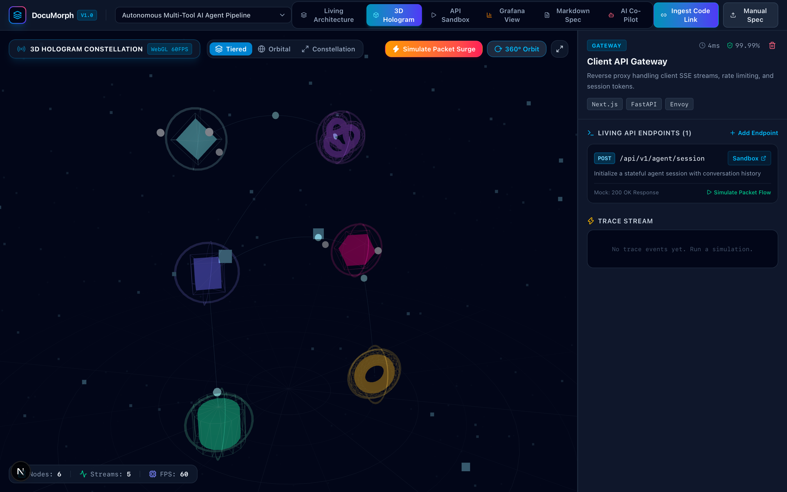
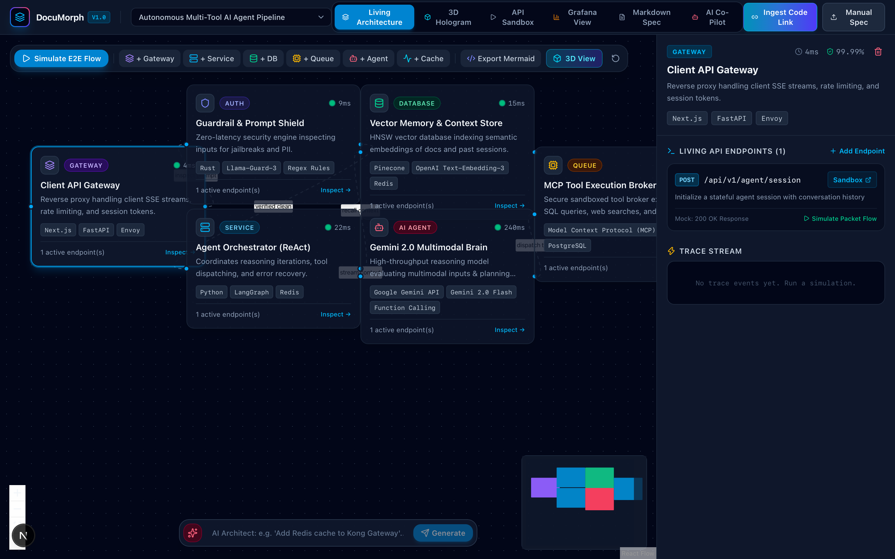
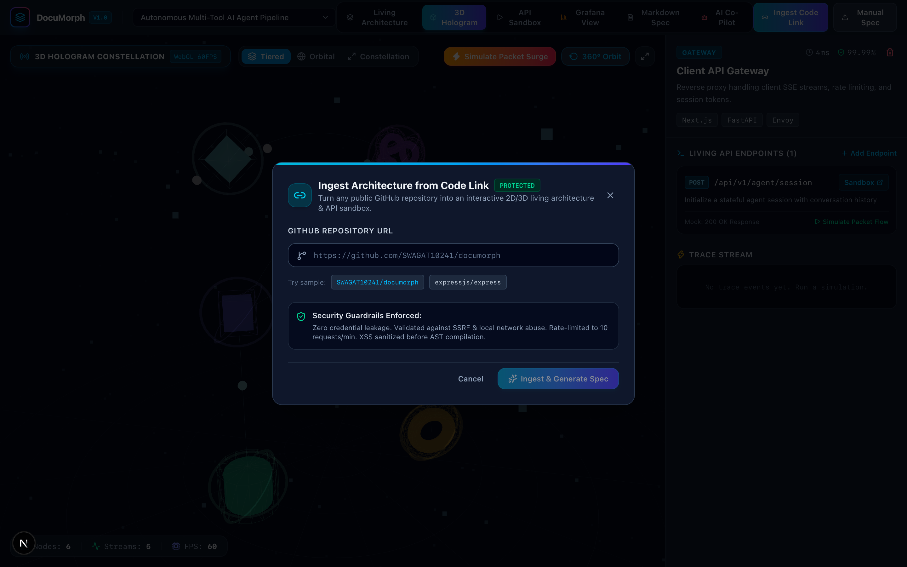
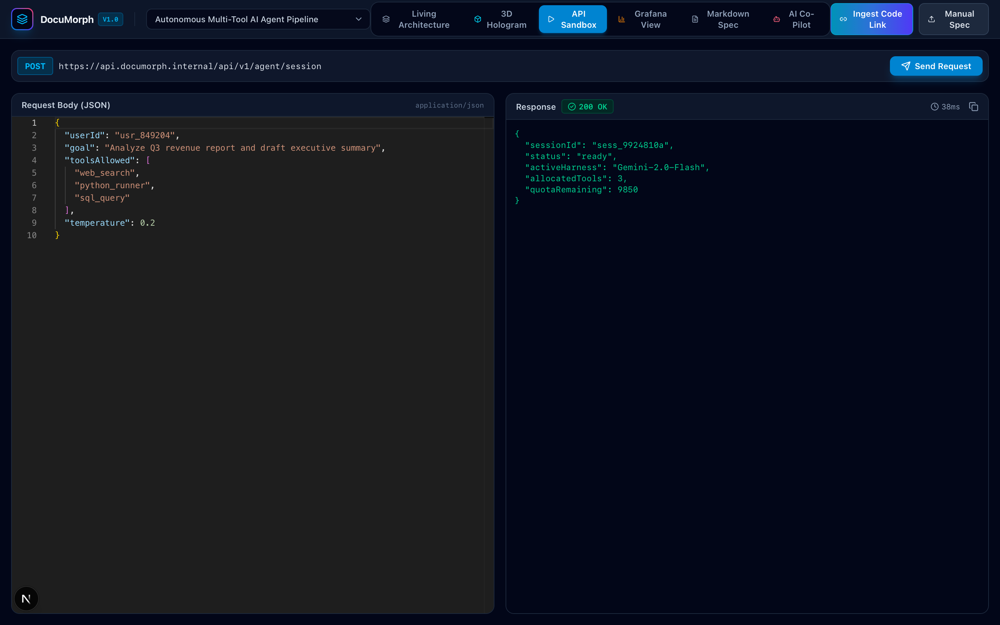
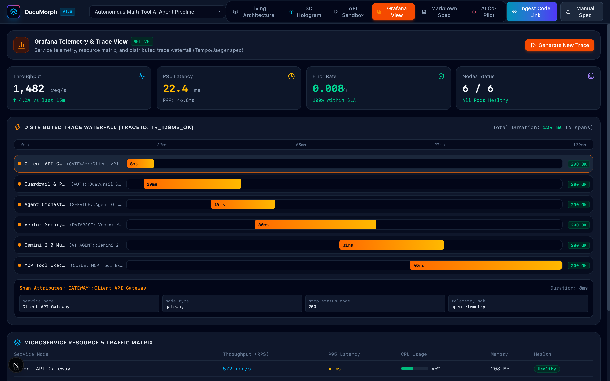

# 📘 DocuMorph: Multimodal Living Documentation & Interactive API Playground

[](https://github.com/SWAGAT10241/documorph/actions/workflows/ci.yml)
[](https://github.com/SWAGAT10241/documorph/actions/workflows/security.yml)
[](LICENSE)
[](https://nextjs.org/)
[](https://react.dev/)
[](https://threejs.org/)
[](https://events.mlh.io)

> **Built for Global Hack Week: Builders Week (MLH, Nov 6–12, 2026)**  
> *Transform static technical documentation, architecture specs, and GitHub code into interactive 2D/3D living system diagrams and runnable API sandboxes.*

---

## 📸 Visual Showcase & Interactive Demos

| 🌌 3D WebGL Hologram Constellation | 🗺️ Living 2D Architecture Canvas |
|:---:|:---:|
|  |  |

| 🔗 Enterprise Code Link Ingestor | 🎮 Living API Sandbox |
|:---:|:---:|
|  |  |

| 📊 Grafana Observability Dashboard |
|:---:|
|  |

---

## 🌟 Why DocuMorph?

Technical specifications and architecture PDFs are typically passive, dense, and disconnected from runtime reality:
1. **Developers scan without grasping architecture:** Complex data flows and event backbones get buried in paragraphs of text.
2. **Disconnected testing:** Developers copy-paste cURL commands or endpoints into external tools (Postman, terminal).
3. **Static diagrams:** Architecture figures in markdown are dead pixels—you cannot click a microservice node to see its schema or live endpoint status.
4. **Code-to-spec divergence:** Code changes every day, while architecture documentation slowly rots.

**DocuMorph** bridges documentation, 3D WebGL diagramming, sandboxing, and observability into a single unified workspace.

---

## 🚀 Key Features

### 🌌 1. Interactive 3D WebGL Hologram Constellation
- **Full 3D Spatial Topology:** Powered by Three.js, rendering microservices as floating volumetric neon nodes in 3D WebGL space.
- **Role-Based 3D Geometry:** Edge Gateways (octahedrons with rotating gyroscopes), AI Agents (rose icosahedrons with orbiting quantum satellites), Databases (emerald cylinders), and Message Queues (amber toruses).
- **Arched 3D Edge Beams & Packet Streams:** Curved quadratic bezier connections with continuous luminous light packets traveling in real time.
- **Multiple Layout Modes:** Switch between **Tiered** (hierarchical layers), **Orbital** (galaxy core), and **Constellation** (spherical matrix) layouts.
- **Raycast HUD & 360° Orbit:** Hover any 3D node for real-time P95 latency and SLA tooltips; click to focus and inspect in the side panel.

### 🔗 2. Ingest Architecture from Code Link
- **Instant GitHub Synthesis:** Paste any public GitHub repository link (e.g. `https://github.com/SWAGAT10241/documorph`) to automatically extract the technology stack, microservices, and live endpoints.
- **Enterprise-Grade Security Architecture:**
  - **In-Memory Sliding-Window Rate Limiter:** 10 requests / minute per client IP (`429 Too Many Requests`).
  - **SSRF Prevention:** Strict domain whitelisting, rejecting private networks (`10.0.0.0/8`, `172.16.0.0/12`, `192.168.0.0/16`, `127.0.0.1`, `localhost`, `169.254.169.254`).
  - **Runtime Zod Validation:** Schema validation on all incoming ingestion requests.
  - **XSS Sanitizer:** Deep scrubbing of script tags and event handlers before rendering.
  - **Timeout Protection:** 8-second `AbortController` timeout mitigating slowloris attacks.

### 🗺️ 3. Living 2D Architecture Canvas
- Powered by `@xyflow/react` (React Flow) with drag-and-drop edge wiring, health indicators, and latency badges.
- **Architecture Studio Palette:** Quick-add node palette (`+ Gateway`, `+ Service`, `+ DB`, `+ Queue`, `+ Agent`, `+ Cache`).
- **AI Architecture Generator:** Natural language prompt input to synthesize nodes and connections on the fly.
- **Mermaid.js Exporter:** Export graphs to markdown diagrams with one click.

### 📊 4. Grafana-Style Observability Dashboard
- **Real-Time KPI Cards with 3D Tilt:** Throughput (RPS), P95 latency, error rate, and pod health with dynamic hover parallax and holographic specular shine.
- **Grafana Tempo Waterfall Trace Viewer:** Interactive span timeline detailing parent/child execution offsets and microservice latencies.
- **Microservice Resource Matrix:** CPU utilization, memory footprints, and SLA compliance tables.

### 🎮 5. In-Browser Living API Sandbox
- Built-in Monaco Editor with syntax highlighting, JSON formatting, and sample payload injection.
- End-to-end packet traversal simulation across the microservice graph on execution dispatch.

### 🤖 6. Multimodal Technical Co-Pilot
- Context-aware AI assistant focused on the active architecture spec, offering failover strategies and latency optimizations.

---

## 🛠️ Tech Stack

- **Framework:** Next.js 16 (App Router, React 19)
- **3D Graphics & WebGL:** Three.js 0.186
- **Visuals & 2D Graphs:** `@xyflow/react` (React Flow)
- **Editor:** `@monaco-editor/react`
- **Styling:** Tailwind CSS v4, Lucide Icons
- **State Management:** Zustand
- **Security & Validation:** Zod
- **Package Manager:** pnpm

---

## 📚 Project Documentation & Wiki

Explore our comprehensive project documentation:

- 🏛️ [ARCHITECTURE.md](ARCHITECTURE.md) — Comprehensive technical architecture, topology, and subsystem specifications.
- 📖 [GitHub Wiki / Documentation Suite](docs/wiki/Home.md) — Complete deep-dive guides:
  - [3D Hologram & WebGL Constellation](docs/wiki/3D-Hologram-Constellation.md)
  - [Code Link Ingestor & Security Architecture](docs/wiki/Code-Link-Ingestion-and-Security.md)
  - [Grafana Observability & Distributed Tracing](docs/wiki/Observability-and-Grafana-Tracing.md)
  - [Architecture & Design System](docs/wiki/Architecture-and-Extensibility.md)
- 🤖 [AGENTS.md](AGENTS.md) — Autonomous agent instructions, invariants, and Graphify traversal knowledge graph.
- 📐 [GEMINI.md](GEMINI.md) — AI Pair-Programming Rules, coding standards, and quality verification gates.
- 🛡️ [SECURITY.md](SECURITY.md) — Vulnerability disclosure policy, response SLAs, and client-side sandbox isolation.
- 🤝 [CONTRIBUTING.md](CONTRIBUTING.md) — Local development guidelines, branching strategy, and PR workflow.
- 📜 [CODE_OF_CONDUCT.md](CODE_OF_CONDUCT.md) — Contributor Covenant Code of Conduct.
- ⚖️ [LICENSE](LICENSE) — MIT License.

---

## 🏁 Quickstart

```bash
# 1. Clone the repository
git clone https://github.com/SWAGAT10241/documorph.git
cd documorph

# 2. Install dependencies
pnpm install

# 3. Start the development server
pnpm dev
```

Open [http://localhost:3000](http://localhost:3000) with your browser to experience DocuMorph.
