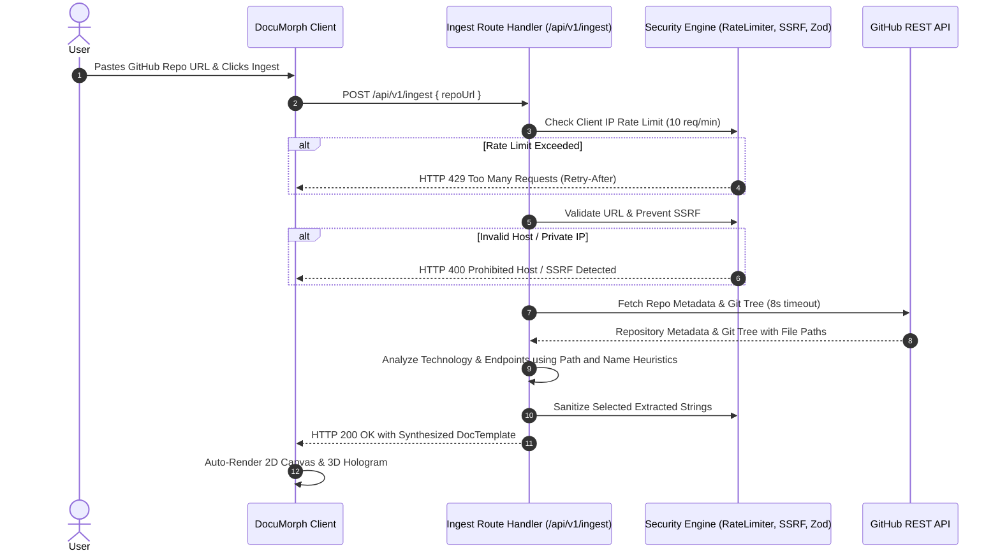

# 🔗 Code Link Ingestion & Security Architecture

DocuMorph allows developers to paste any public GitHub repository link (e.g. `https://github.com/SWAGAT10241/documorph`) and automatically synthesizes a living architecture diagram, 3D hologram constellation, interactive API sandbox, and markdown documentation.

---

## 1. End-to-End Ingestion Flow



---

## 2. Security Guardrails Specification

### A. Sliding-Window Rate Limiting (`src/lib/security/rateLimiter.ts`)
- **Limit:** 10 ingestion requests per minute per IP address.
- **Window:** 60,000 milliseconds sliding window.
- **Headers:** Responds with standard rate-limit headers:
  - `Retry-After`: Seconds until the oldest request expires from the window.
  - `X-RateLimit-Limit`: Maximum requests permitted per window.
  - `X-RateLimit-Remaining`: Available quota remaining.
- **Memory Cleanup:** Automatically deletes stale IPs every 5 minutes to prevent memory leaks.

### B. SSRF Prevention & Target Isolation (`src/lib/security/urlValidator.ts`)
To prevent Server-Side Request Forgery (SSRF) into cloud metadata or internal microservice endpoints, the validator enforces:
1. **Protocol:** Must strictly be `https:`.
2. **Host Whitelist:** Exclusively `github.com` or `raw.githubusercontent.com`.
3. **Blocked Hostnames:** `localhost`, `127.0.0.1`, `0.0.0.0`, `::1`, `169.254.169.254`, `metadata.google.internal`.
<!-- coderabbit-ai-generated:v1 -->

<!-- coderabbit-ai-generated-section:v1:afacced093fd73d957493a62acbd8891f8dd46e30b8527c03e8a77ca67c1d40a -->

4. **Private IP Patterns:** `validateAndParseGitHubUrl` checks the parsed hostname string against patterns for `10.`, `172.16.` through `172.31.`, `192.168.`, `127.`, `fc00:`, and `fe80:`. It does not resolve hostnames through DNS or inspect resolved addresses.

<!-- /coderabbit-ai-generated:v1 -->
5. **Credential Stripping:** Rejects URLs containing embedded basic auth (`user:pass@host`).
6. **Identifier Sanitization:** Owner and repo names must match `^[a-zA-Z0-9_.-]+$`.

### C. Runtime Input Validation (`src/app/api/v1/ingest/route.ts`)
Uses **Zod** schema validation to reject malformed payloads before processing:
```ts
const IngestRequestSchema = z.object({
  repoUrl: z
    .string()
    .url('Must be a valid URL format.')
    .max(500, 'URL exceeds maximum length of 500 characters.'),
});
```

### D. XSS & Content Scrubbing (`src/lib/security/sanitizer.ts`)
<!-- coderabbit-ai-generated:v1 -->

<!-- coderabbit-ai-generated-section:v1:193b61969298d3bf746bd24278b9465ed0e10a2e7f9d975f4792e4f08ab3152b -->

`sanitizeString` attempts to remove `javascript:`, `data:`, and `vbscript:` text, rewrite word-initial `on` prefixes, escape `&`, `<`, `>`, double quotes, and single quotes, and trim whitespace. It does not parse or remove HTML elements or attributes.

The replacement loop repeatedly escapes ampersands, so inputs containing or producing an ampersand do not terminate.

<!-- /coderabbit-ai-generated:v1 -->

### E. Timeout Protection
<!-- coderabbit-ai-generated:v1 -->

<!-- coderabbit-ai-generated-section:v1:49c7de64618bd3c32b25a0d2b1f4c8d5e61267558f1c32c672a1f3a7ca732356 -->

An `AbortController` uses a shared **8,000 ms** timeout for the outbound GitHub API calls. It starts after the request body is read and does not cover slow client request-body uploads.

<!-- /coderabbit-ai-generated:v1 -->

---

## 3. Technology & Framework Detection Rules

<!-- coderabbit-ai-generated:v1 -->

<!-- coderabbit-ai-generated-section:v1:7991bf2c85d30a0c498c4a95d3c0b8f121a8f09cf52e1b3362bb9d56084c4e25 -->

The ingestion engine uses repository metadata and file-path heuristics to emit the repository language and these labels:
- **Frontend:** Next.js or React, Vue.js, Tailwind CSS. A Nuxt configuration contributes to Vue.js detection.
- **Backend:** Express.js, FastAPI.
- **Persistence:** PostgreSQL, MongoDB, Prisma ORM, Drizzle ORM. A Mongoose path contributes to MongoDB detection.
- **In-Memory & Cache:** Redis Cache.
- **AI & LLMs:** AI / LLM Integration.
- **DevOps:** Docker.

<!-- /coderabbit-ai-generated:v1 -->

---

## 4. API Endpoints Extraction

Scans routes under `/app/api/**`, `/api/**`, `/routes/**`, and `/controllers/**`, extracting:
<!-- coderabbit-ai-generated:v1 -->

<!-- coderabbit-ai-generated-section:v1:9036d9769c2d30ed07b5e4e2f8f44cf75ef5e6d0c9797395f389e59ecd328e58 -->

- HTTP method inferred from the normalized path: `POST` if it contains `create`, `auth`, or `post`; otherwise `GET`.

<!-- /coderabbit-ai-generated:v1 -->
- Standardized route paths (e.g. `/api/v1/projects`, `/api/auth/session`).
- Creates interactive mock payloads ready for testing in the living sandbox!
