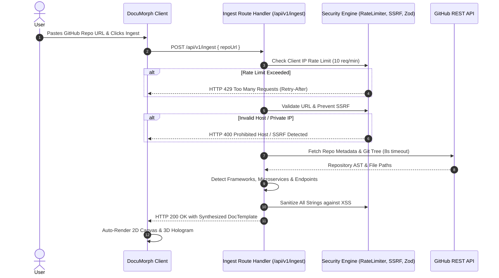

# 🔗 Code Link Ingestion & Security Architecture

DocuMorph allows developers to paste any public GitHub repository link (e.g. `https://github.com/SWAGAT10241/documorph`) and automatically synthesizes a living architecture diagram, 3D hologram constellation, interactive API sandbox, and markdown documentation.

---

## 1. End-to-End Ingestion Flow



---

## 2. Security Guardrails Specification

### A. Sliding-Window Rate Limiting (`src/lib/security/rateLimiter.ts`)
- **Limit:** 10 ingestion requests per minute per IP address.
- **Window:** 60,000 milliseconds sliding window.
- **Headers:** Responds with standard rate-limit headers:
  - `Retry-After`: Seconds until the oldest request expires from the window.
  - `X-RateLimit-Limit`: Maximum requests permitted per window.
  - `X-RateLimit-Remaining`: Available quota remaining.
- **Memory Cleanup:** Automatically deletes stale IPs every 5 minutes to prevent memory leaks.

### B. SSRF Prevention & Target Isolation (`src/lib/security/urlValidator.ts`)
To prevent Server-Side Request Forgery (SSRF) into cloud metadata or internal microservice endpoints, the validator enforces:
1. **Protocol:** Must strictly be `https:`.
2. **Host Whitelist:** Exclusively `github.com` or `raw.githubusercontent.com`.
3. **Blocked Hostnames:** `localhost`, `127.0.0.1`, `0.0.0.0`, `::1`, `169.254.169.254`, `metadata.google.internal`.
4. **Private IP Ranges:** Rejects any IP resolves targeting `10.0.0.0/8`, `172.16.0.0/12`, `192.168.0.0/16`, `127.0.0.0/8`, `fc00::/7`, `fe80::/10`.
5. **Credential Stripping:** Rejects URLs containing embedded basic auth (`user:pass@host`).
6. **Identifier Sanitization:** Owner and repo names must match `^[a-zA-Z0-9_.-]+$`.

### C. Runtime Input Validation (`src/app/api/v1/ingest/route.ts`)
Uses **Zod** schema validation to reject malformed payloads before processing:
```ts
const IngestRequestSchema = z.object({
  repoUrl: z
    .string()
    .url('Must be a valid URL format.')
    .max(500, 'URL exceeds maximum length of 500 characters.'),
});
```

### D. XSS & Content Scrubbing (`src/lib/security/sanitizer.ts`)
Cleanses all extracted strings before injecting into the React state store or Monaco editor:
- Strips `<script>` and `<iframe>` tags.
- Removes `javascript:` pseudo-protocols.
- Strips event handlers (`onload=`, `onerror=`, `onclick=`).
- Escapes unclosed HTML brackets.

### E. Timeout Protection
Sets an `AbortController` timeout of **8,000 ms** on all external GitHub API calls to prevent slowloris connection-holding attacks.

---

## 3. Technology & Framework Detection Rules

The ingestion engine analyzes repository trees and dependency manifests to automatically recognize:
- **Frontend:** Next.js, React, Vue.js, Nuxt, Tailwind CSS.
- **Backend:** Express.js, Fastify, NestJS, FastAPI, Django, Flask, Gin.
- **Persistence:** PostgreSQL, MongoDB, Prisma ORM, Drizzle ORM, TypeORM, Mongoose.
- **In-Memory & Cache:** Redis, Memcached.
- **Message Brokers:** Apache Kafka, RabbitMQ, BullMQ, AWS SQS.
- **AI & LLMs:** Google Gemini, Gemma, LangChain, OpenAI, LlamaIndex.
- **DevOps:** Docker, Kubernetes, GitHub Actions CI/CD.

---

## 4. API Endpoints Extraction

Scans routes under `/app/api/**`, `/api/**`, `/routes/**`, and `/controllers/**`, extracting:
- HTTP Methods (`GET`, `POST`, `PUT`, `DELETE`, `PATCH`).
- Standardized route paths (e.g. `/api/v1/projects`, `/api/auth/session`).
- Creates interactive mock payloads ready for testing in the living sandbox!
