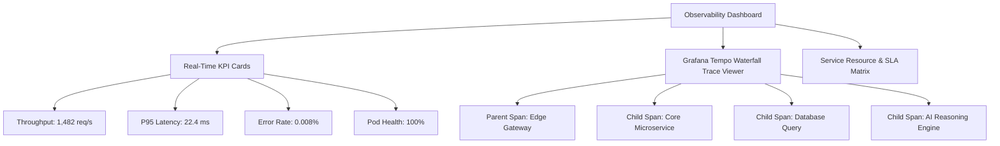

# 📊 Observability & Grafana Tracing Suite

DocuMorph incorporates a built-in **Grafana-Style Observability Dashboard**, allowing developers to monitor distributed system health, latency SLAs, throughput, and waterfall execution traces without leaving the documentation view.

---

## 1. Dashboard Subsystems

---

## 2. Interactive 3D KPI Metric Cards

The top metrics row renders key performance indicators formatted like Grafana Big Stat panels:
- **Throughput (req/s)**: Real-time query volume with trend indicators.
- **P95 Latency (ms)**: 95th percentile response latency compared against P99 bounds.
- **Error Rate (%)**: Calculated HTTP 4xx/5xx frequency against SLA thresholds.
- **Service Mesh Pods**: Active pods count and overall health status.

### 3D Perspective Tilt Interactivity
Every KPI card is wrapped in the [`Card3DTilt`](../../src/components/ui/Card3DTilt.tsx) component:
- Computes pointer coordinates relative to card center on `onMouseMove`.
- Applies dynamic 3D perspective rotation:
  $$\text{rotateX} = \frac{-(y - \text{centerY})}{\text{centerY}} \times \text{maxTilt}, \quad \text{rotateY} = \frac{(x - \text{centerX})}{\text{centerX}} \times \text{maxTilt}$$
- Renders a radial specular holographic glare following cursor movement.
- Built-in accessibility: Automatically disabled when `prefers-reduced-motion` is detected.

---

## 3. Grafana Tempo Waterfall Trace Viewer

DocuMorph simulates OpenTelemetry-compliant distributed tracing spans across the microservice topology:
- **Trace Hierarchy**: Renders parent and child spans with depth indentation.
- **Relative Offset & Duration**: Calculates start offset (`offsetMs`) and execution duration (`durationMs`) relative to the total trace timeline:
  $$\text{barLeft} = \frac{\text{offsetMs}}{\text{totalDuration}} \times 100\%, \quad \text{barWidth} = \frac{\text{durationMs}}{\text{totalDuration}} \times 100\%$$
- **Color-Coded Service Spans**:
  - Sky Blue: Edge Gateway
  - Indigo: Core Microservice
  - Emerald: Database / Storage
  - Rose: AI Agent Reasoning
  - Amber: Message Broker / Queue

---

## 4. Microservice Resource Matrix

A telemetry table listing each microservice in the active specification:
- Microservice name & role badge.
- Current CPU and RAM consumption.
- P50, P95, and P99 latency percentiles.
- Health status indicator with active pod count.
